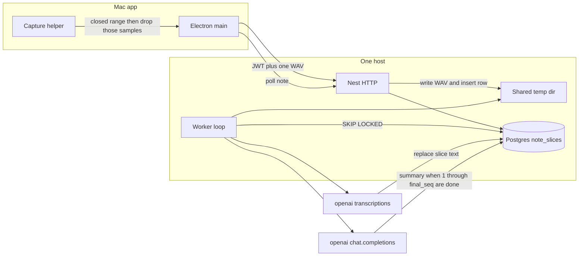

# Transcription latency and concurrent users

An hour-long meeting currently waits more than ten minutes after **Generate** before the summary appears. Nothing is transcribed while the meeting is still being recorded, and each slice of audio is sent and recognized one after another. The same server also has no queue for several people doing this at once.

This note describes the algorithm that runs today, why that wait happens, and how to fix both problems. Capture itself stays as it is: the microphone and the system-audio tap are not part of this change.

## What the user waits for

**Generate** does not show a summary until every step below has finished.

1. The Mac stops the microphone and the system-audio tap and waits until that hardware is released.
2. The whole recording is still in memory: the mix, the mic track, and the system track. Each is 16-bit PCM, mono, 16 kHz (about 1.9 MB per minute per track).
3. The Mac cuts that audio into speech slices and uploads them.
4. The server turns each slice into text.
5. The Mac joins the text, creates the note, and asks the server for one summary.
6. Only then does the notes field fill in.

A quiet gap is not uploaded. A meeting where people talk for most of an hour still sends most of that hour, and the screen stays on **Generate** the entire time.

## Algorithm used now

### 1. Record, then stop

Audio is kept on the Mac from the start of the note. No slice is uploaded during the meeting. **Generate** calls `debug:stopAndTranscribe`, which stops capture first and only then starts transcription.

If the recorded length is under `minListenSeconds` from `GET /config`, the audio is discarded and nothing is sent.

### 2. Cut the recording into speech slices on the Mac

`segmentTracks` walks the mic track and the system track in 0.2 second windows.

- Both quiet (peak under 500): silence. That window is not sent.
- One side clearly louder (at least twice the other): that side’s own track is sent, so a YouTube stretch and a later spoken stretch do not share one file.
- Both speaking: the mix is sent, so neither side is dropped.

A run of the same label becomes one slice. Each slice is padded by 0.08 seconds. Slices shorter than about half a second are dropped.

### 3. Upload and recognize one slice at a time

The Mac posts each slice, in order, to `POST /spike/transcribe` and waits for the answer before it sends the next one. The route is dev-only (`NODE_ENV=development` and the `X-Spike-Key` header). It is not a signed-in user route.

For each upload the server:

1. Holds the whole file in memory (ceiling 256 MB).
2. Finds longer silences and splits on them, so one file does not lock the recognizer onto the last language.
3. Splits any remaining piece longer than `WAV_CHUNK_SECONDS` (default 10 minutes) so each call stays under OpenAI’s 25 MB limit. Ten minutes of this WAV is about 19 MB.
4. Calls `gpt-4o-mini-transcribe` on those pieces **one after another**. The next piece starts only when the previous one returns.
5. Joins the text and returns it. The WAV bytes are wiped. They are not stored.

### 4. One summary, after every slice

The Mac cleans the joined transcript, creates the note, and calls `POST /notes/:id/stop` with the text already in hand. The server does not receive the WAV on that route. It makes one `gpt-4o-mini` summary from the first 12,000 characters of that text. The summary is what the notes field shows.

## Why an hour takes more than ten minutes

The wait is the sum of the slices, not a single hour-long job.

- Work starts only when the meeting is over. An hour of talking is still an hour of audio to recognize.
- Slices run in series. If the recognizer takes roughly a fifth to a third of the audio length, sixty minutes of speech is about ten to twenty minutes of calls, plus the upload of each slice.
- The server repeats that series inside one upload whenever a slice is split again.
- The summary cannot start until the last slice returns, and the screen shows nothing until the summary returns.
- A long transcript is also cut at 12,000 characters for the summary, so the extra wait does not even feed the whole meeting into the summary.

## Several users at once, today

The API process can accept more than one request, but a meeting is one long request chain with no shared queue.

- Each slice holds its WAV in that process until the recognizer returns. Several hour-long meetings mean several large buffers at once.
- Every slice for one meeting, and every chunk inside it, uses the OpenAI key one call after another. Twenty users do not get twenty parallel recognizers, and they also do not get a fair line. They pile onto the same process and the same key.
- There is no per-user limit, no retry that survives a restart, and no separation between users. The spike route is one shared key, not the signed-in user.
- If the process restarts mid-meeting, the in-memory audio is gone. The product rule is already that a WAV is not kept overnight. A crash during **Generate** loses the recording.

## Evaluation of the earlier proposal

The direction stands: send closed slices during the meeting, and do not run recognition inside the HTTP request. The signed-in route, the ownership check, and keeping the OpenAI SDK out of the notes module are right.

The earlier write-up is not the design to build. These points from the review are correct, and the solution below follows them.

- Live uploads cannot go first. The current route holds each file until recognition finishes. A timer on top of that would pile up buffers. The bounded accept path comes before any live upload, behind a flag.
- The Swift helper keeps samples in memory and writes the WAVs only on stop. A timer in Electron cannot freeze a slice until the helper can export a closed range and drop those samples. The tap, the mic path, and Bluetooth handling stay as they are. The new call is only “copy samples up to here, then release them.”
- `transcript_turns` is one text column. Ordered slices need their own rows. A retry must replace a slice, not append it again.
- Open-source BullMQ does not rate-limit by user. That feature left in BullMQ 3 and is Pro-only. This product does not add Redis, BullMQ, or any other queue service. The job table lives in the Postgres we already run. More users means more worker loops on that same database, not a new product.
- A path stored in a queue is only valid if the worker can read that disk. One host, one shared temp directory, is enough for now. A daily sweep is too late. Success deletes the file immediately. A failed file lives only long enough for one user retry, and never overnight.
- `recordListen` adds listening time and a note count on every stop that still sees `listening`. The status update is a separate statement. Those two writes have to be one transaction so a retry cannot bill twice.
- “The summary is then one model call” is only true when the transcript fits one request and the slice queue is already caught up. Live upload moves the wait earlier. It does not shrink the amount of audio.

## First version

The only goal of this version is a shorter wait for the summary. Several people can record at the same time. No new infrastructure.

What ships now:

- While a note is recording, every 5 minutes of captured audio is sent and recognized. **Generate** sends only the audio after the last chunk, then one summary joins that text with the tail.
- The summary is one model call over the ordered transcript, up to 100,000 characters.

What does not ship in this version:

- Redis, BullMQ, or any other queue product.
- Object storage. The WAV is a temp file on the API host. The `wav_path` column can point at an object key later if the workers move to another machine. The claim query stays the same.
- A merge of per-slice summaries. That is a second version, and only if a real transcript is too long for one `gpt-4o-mini` request.
- Any change to the tap, the microphone, or Bluetooth. The helper change is one export: freeze a prefix, write it, drop those samples.

## What to change

Build in this order. Each step is usable without the ones after it.

1. Slice rows, a Postgres job queue, a worker with a hard cap, retries, and audio deletion. Still fed only when the user presses **Generate**, so we can measure the queue before the Mac sends during a meeting.
2. A helper export that freezes a closed range and releases those samples. Ship it behind a flag. This is the step that cuts the wait after **Generate**.
3. Seal the note with a final slice number, then summarize. Compare time-to-first-text, queue lag, and Generate-to-summary p50 and p95 against today’s path before the flag defaults on.

### 1. Accept work without doing it in the request

`POST /notes/:id/slices` checks the JWT and that the note belongs to the user. It writes the WAV under a configured temp directory and inserts one job row. The response is `202` and the slice id. OpenAI is not called on this request.

The worker is a loop inside the Nest process, not a request handler. It claims a job with `SELECT … FOR UPDATE SKIP LOCKED`, runs `OpenAiTranscribeService`, and updates that same row. Concurrency starts at 2 in-flight recognitions. Raise it only after watching OpenAI 429s and latency. Do not start at 4–8 because that number looks small. A later process can run the same loop against the same table when one process is not enough.

Fairness is in the claim query. A user who is not already running is taken first, so one meeting cannot block everyone else. If a slot is still free and nobody else is waiting, that meeting can use the second slot. The global cap stays at two recognitions.

### 2. Export a closed range while capture continues

Add one helper command. It does not retune the tap, the mic, or Bluetooth.

- Freeze the sample index at the moment of the call. Samples after that index stay in the arrays and keep recording.
- Write a WAV of the mic, system, and mix for the frozen prefix, using the same canonical format as stop.
- Drop the frozen prefix from the arrays so the Mac does not keep the whole hour.
- Return the range in host time. `seq` is a counter on the Mac, starting at 1, never reused. A pause does not reset it. A retry resends the same `seq` and the same bytes.

Electron main runs `segmentTracks` on that prefix only, and posts each speech slice. Silence is still dropped. The open tail is not sent until the next export, or until **Generate**.

The notes field can show turns as rows land, while status stays `listening`. **Generate** exports the tail, stops the helper, and seals the note. If the flag is off, behavior stays the current stop-then-transcribe path.

### 3. One row per slice, then one summary

```text
note_slices
  note_id, seq            unique together
  user_id
  status                  queued | running | done | failed
  source, start_sec, end_sec
  wav_path                null once the file is deleted
  transcript              replaced on retry, never appended
  attempts, locked_at, finished_at
```

`notes.final_seq` is null while listening. **Generate** sets it once, in the same transaction that moves the note from `listening` or `paused` to `processing` and calls `recordListen`. A second stop sees `processing` and does not add usage again.

The summary job runs only when every slice from 1 through `final_seq` is `done`. The text sent to the model is those rows in `seq` order, not a string append. If any slice is `failed` and its file is already gone, the note becomes `incomplete`. We do not summarize that note as if the meeting were complete. While the file is still on disk the user can retry that slice. After a successful retry, the summary runs.

Summary strategy for this version: one `chat.completions` call over the ordered transcript. Raise the input limit from 12,000 characters to the budget `gpt-4o-mini` can take in one request. A merge of per-slice summaries is not in this version. It adds calls and can drop a decision that only makes sense across slices. Add it later only if a real transcript still does not fit.

### Audio lifetime

- The temp directory is on a volume the API and the worker both mount. A path in Postgres is useless if the worker is on another disk.
- Delete the WAV as soon as the slice is `done`.
- On the last failed attempt, keep the file for two hours so the user can retry, then delete it and leave the slice `failed`. A process restart deletes nothing that is still inside that window. It does delete files whose row is already `done` or whose deadline has passed.
- No WAV is still on disk the next calendar day.

### What the Mac calls

Renderer to main process, then `Authorization: Bearer`, same as the other note routes.

- `POST /notes/:id/slices` multipart `audio`, plus `seq`, `startSec`, `endSec`, `source`. `202` and `{ sliceId }`. Posting the same `seq` again updates that row if it is `failed` or still `queued`. It does not insert a second row.
- `GET /notes/:id` returns turns for the contiguous done prefix only (`seq` 1..N with no hole). A finished slice 4 is hidden until 1–3 are done.
- `POST /notes/:id/stop` seals `final_seq` after the tail slices are accepted. It does not carry the whole transcript in the body anymore once the flag is on.

`POST /spike/transcribe` stays dev-only. The worker calls `OpenAiTranscribeService` and `splitWavBySeconds` directly.

## Libraries in the product today

| Piece              | Library                                                | Role in this path                                                                                                          |
| ------------------ | ------------------------------------------------------ | -------------------------------------------------------------------------------------------------------------------------- |
| Mac app            | Electron 34, TypeScript                                | Main process owns the token and the capture helper. The renderer never holds the JWT.                                      |
| Upload             | `form-data`                                            | The main process posts each WAV as multipart field `audio`.                                                                |
| Capture            | Swift helper (`AVAudioEngine`, Core Audio process tap) | Writes the three 16 kHz mono WAVs on stop today. The fix adds one export of a closed range. The tap and the mic path stay. |
| API                | NestJS 11 on Express                                   | One Node process. `multer` memory storage holds the upload.                                                                |
| Auth               | `jsonwebtoken`, `AuthGuard`                            | Signed-in notes. The live spike route ignores this and uses `X-Spike-Key`.                                                 |
| Database           | `pg`, Postgres                                         | Notes, users, plans. The queue is a new `note_slices` table in this same database.                                         |
| Speech and summary | `openai` 4.77                                          | `audio.transcriptions` with `gpt-4o-mini-transcribe`, then `chat.completions` with `gpt-4o-mini`.                          |

There is no queue library and no Redis. Recognition runs inside the HTTP handler that received the file. That stays true until the worker below is running.

## Architecture of the fix



Two processes on one machine. The HTTP process only accepts the file. The worker is the only caller of OpenAI.

1. **Electron main** asks the helper for a frozen prefix, runs `segmentTracks` on that prefix, and posts each speech slice. **Generate** does the same for the tail, then stops the helper.
2. **Nest HTTP** checks the JWT and note ownership, writes the WAV to the shared temp directory, and upserts `note_slices`. The response does not wait for speech recognition.
3. **Worker** claims with `FOR UPDATE SKIP LOCKED`, at most one running slice per user, and at most two recognitions in flight until measured limits say otherwise. It writes the transcript onto that row and deletes the file. The summary call runs only when slices `1` through `final_seq` are `done`.

Notes code still does not import the OpenAI SDK. The worker uses the transcribe module and the summary module.

### Libraries to add

None for the queue. `pg` is already the client. The worker is a Nest provider started next to the HTTP server, or a second `node` process with the same `DATABASE_URL` and the same temp directory. A new package is not what makes the jobs durable.

No Redis and no BullMQ. A Postgres row is the job, the idempotency key, and the transcript. More capacity is another worker loop on this database. If the WAV files later have to leave this machine, `wav_path` becomes an object key. The claim query does not change, and that storage move is not part of this version.

| Piece                   | Library                                                             | Role                                                                                         |
| ----------------------- | ------------------------------------------------------------------- | -------------------------------------------------------------------------------------------- |
| Job row and claim       | `pg`                                                                | `INSERT … ON CONFLICT (note_id, seq)`, then `SELECT … FOR UPDATE SKIP LOCKED`.               |
| WAV bytes               | Node `fs`                                                           | Temp directory shared by the API and the worker. Not in Postgres and not in a queue payload. |
| Recognition and summary | `openai`, already depended on                                       | Same two services as today.                                                                  |
| Upload                  | `multer` disk storage, or memory only long enough to `fs.writeFile` | The request must not keep the buffer after the file is on disk.                              |

### Claim rule

```sql
SELECT id
FROM note_slices
WHERE status = 'queued'
  AND user_id NOT IN (
    SELECT user_id FROM note_slices WHERE status = 'running'
  )
ORDER BY created_at
FOR UPDATE SKIP LOCKED
LIMIT 1
```

A user who already has a running slice is skipped. Their other slices stay queued. Attempts stop at 3, with backoff stored on the row (`locked_at`). A crash leaves `running` past a timeout; the next claim treats that row as queued again and overwrites `transcript` rather than appending.

### What we will measure before the flag defaults on

- Time from the first slice accept to the first `done` row.
- Queue lag: age of the oldest `queued` row, at 1, 5, and 20 concurrent notes.
- Generate-to-summary p50 and p95, with the flag on and off, on a one-hour fixture.
- Peak WAV bytes on disk and peak samples still held in the helper.

## What this does not change

- The microphone device, the system-audio tap, Bluetooth handling, and the mix format stay as they are. The helper gains an export of a prefix and then drops that prefix.
- Audio is still not the saved product. The saved note is the ordered slice text and the summary.
- The summary is still one structured note in the meeting language. It is written only after slices `1` through `final_seq` have succeeded.
- `POST /spike/transcribe` stays a dev-only route. The live path is the signed-in slice route.
- A note with a failed slice whose file is gone is `incomplete`. It is not given a summary that pretends the missing speech was heard.
